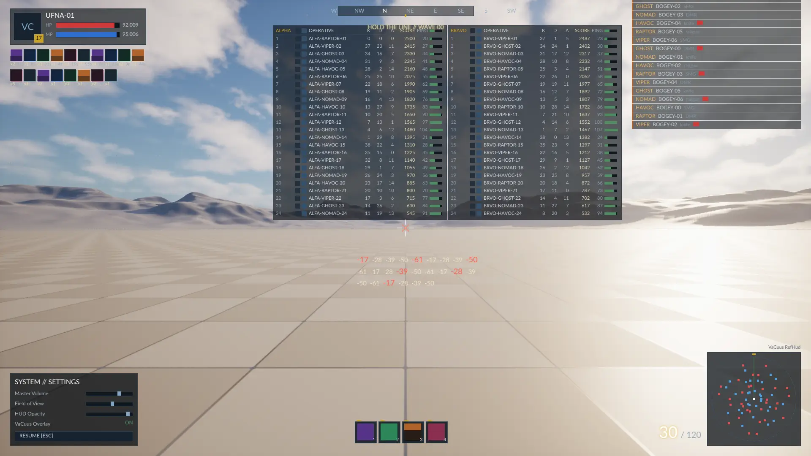
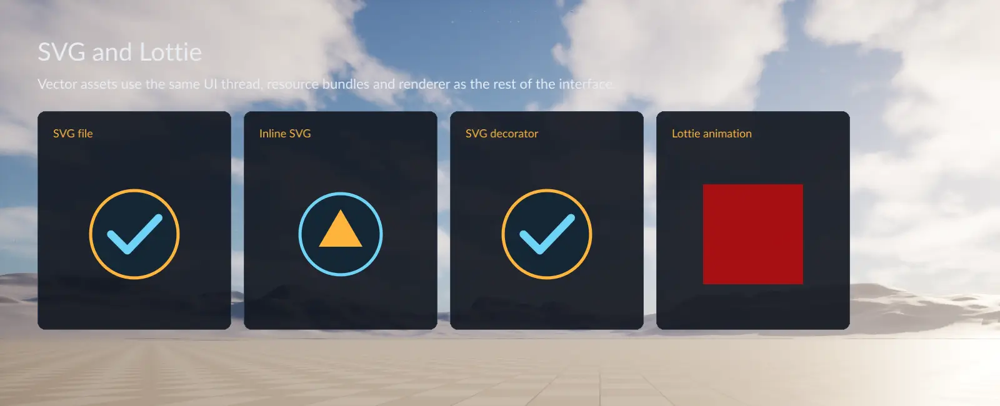
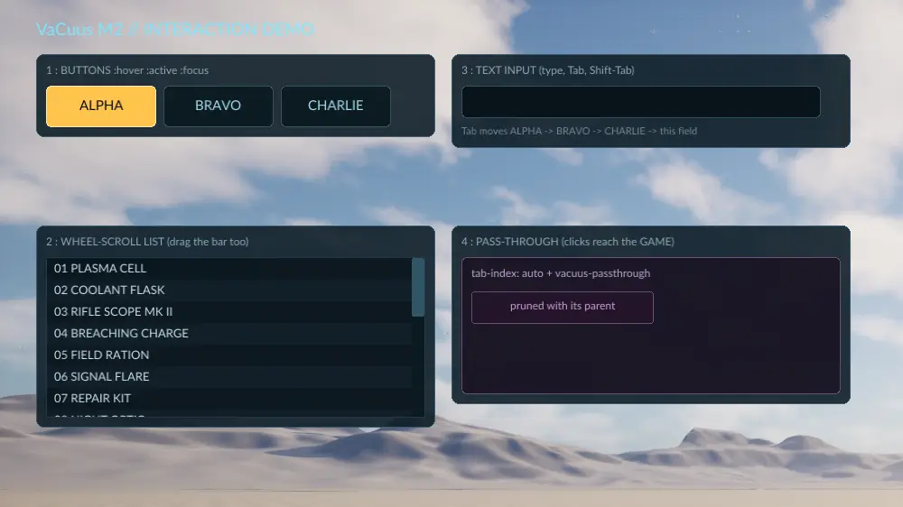
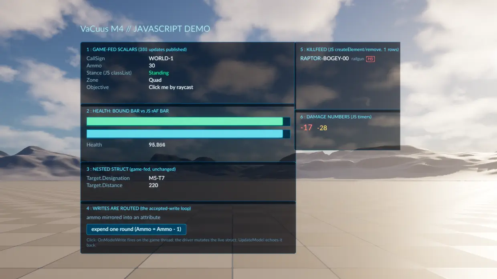
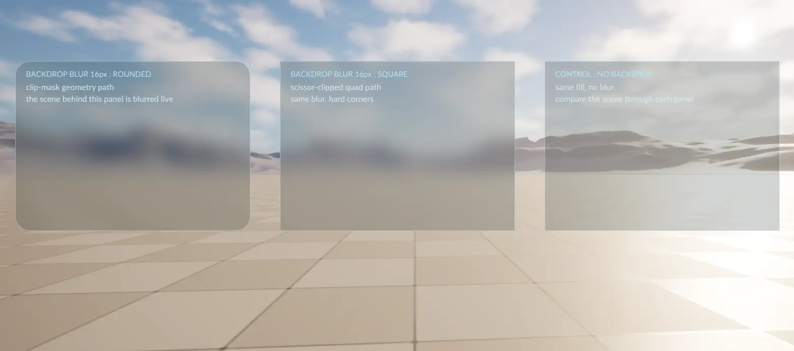
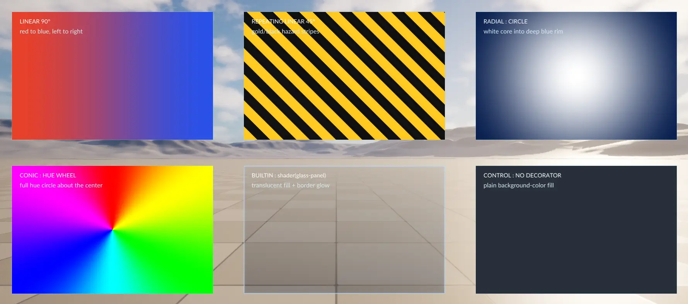

<!--
  Images are linked by RELATIVE path and live in docs/marketing/ (sources and recipes:
  docs/marketing/README.md). This file also ships inside the plugin package
  (Config/FilterPlugin.ini, /README.md) and docs/marketing/ does not, so the packaged copy shows
  each image's alt text instead -- accepted: only docs/buyer/ ships (Tools/fab_inventory.sh).
  Rasters are .webp on purpose: *.png is Git LFS here, and LFS bills every README view.
-->

<p align="center">
  <a href="https://vacuus.ufna.dev/">
    <picture>
      <source media="(prefers-color-scheme: dark)" srcset="docs/marketing/brand/vacuus-wordmark-dark.svg" />
      
    </picture>
  </a>
</p>

<p align="center">
  <strong>Game UI in HTML/CSS for Unreal Engine — rendered off the game thread.</strong><br />
  RmlUi layout and styling, optional JavaScript, on a dedicated UI thread —<br />
  the game thread pays for a queue write and a snapshot read, nothing else.
</p>

<p align="center">
  <a href="docs/buyer/setup.md">Get started</a> &nbsp;|&nbsp;
  <a href="#features">Features</a> &nbsp;|&nbsp;
  <a href="#measured-not-promised">Performance</a> &nbsp;|&nbsp;
  <a href="https://vacuus.ufna.dev/">Website</a> &nbsp;|&nbsp;
  <a href="https://github.com/ufna/VaCuus/releases">Download</a> &nbsp;|&nbsp;
  <a href="https://fab.com/s/6571fd1716eb">Fab</a>
</p>

<p align="center">
  <a href="https://github.com/ufna/VaCuus/releases/latest"></a>
  <a href="docs/buyer/setup.md"></a>
  <a href="docs/buyer/setup.md"></a>
  <a href="LICENSE.md"></a>
</p>

<p align="center">
  <a href="site/public/shots/refhud.png"></a><br />
  <sub><code>vacuus.RefHud</code> — the reference HUD the plugin ships and measures itself against: 1,732 live nodes over an Unreal level, captured headless.</sub>
</p>

You author screens as `.rml`/`.rcss` documents — the web languages, not a UMG graph — and
the plugin runs them on its own UI thread: layout, styling and draw-command recording all
happen away from the game thread, which only enqueues input and reads back a snapshot.
Optional JavaScript (QuickJS) and a TypeScript/Preact workflow sit on top. Rendering goes
through the engine's RHI into a persistent render target that Slate composites, so a
document can be a full-screen HUD or a panel on a quad in the world.

> **Status: released, 1.3.0. Engines: UE 5.6, 5.7 and 5.8.** The 5.6 and 5.8
> packages compile from this one source tree; the 5.7 package is derived from the 5.6
> build with its provenance stated in the release notes. The 295-test automation suite
> ships with the plugin and can be run locally (below). Supported platforms are Windows,
> macOS, Linux, Android and iOS; consoles on request. Packages are published on
> [GitHub Releases](https://github.com/ufna/VaCuus/releases), one archive per engine
> (`VaCuus-<version>-UE5.8.zip` and its 5.6 and 5.7 siblings). Take the download that
> matches your engine ([`docs/buyer/setup.md`](docs/buyer/setup.md) says how to check).
> The API is stable — breaking changes are reserved for major versions and carry
> release notes.

## Features

SVG files, inline SVG, SVG decorators and Lottie animations are built in. See
[vector assets](docs/buyer/vector-assets.md) for markup, resource paths and cost,
or run `vacuus.VectorDemo` in the editor.

<table>
  <tr>
    <td width="42%" valign="middle">
      <h3>Vector art and animation</h3>
      <p>Use SVG files, inline SVG or SVG decorators for icons and artwork. Play Lottie animations from JSON, with resources loaded from the same cooked bundles as the rest of your interface.</p>
      <p><a href="docs/buyer/vector-assets.md">SVG and Lottie guide</a></p>
    </td>
    <td width="58%">
      <a href="site/public/shots/vectors.png"></a>
    </td>
  </tr>
  <tr>
    <td width="42%" valign="middle">
      <h3>The web's languages, a game's input</h3>
      <p>Screens are plain <code>.rml</code> and <code>.rcss</code> files on disk. <code>:hover</code>, <code>:active</code> and <code>:focus</code>, Tab navigation, text input with IME, wheel-scrolled lists — and clicks that pass through the UI to the game where you say so. Save the file and the editor live-reloads the document, no recompile.</p>
      <p>Bind <code>UPROPERTY</code> data straight into the markup, script it in JavaScript, or author in TSX with Preact via <code>vacuus dev</code>.</p>
    </td>
    <td width="58%">
      <a href="site/public/shots/m2demo.png"></a>
    </td>
  </tr>
  <tr>
    <td valign="middle">
      <h3>On the screen, or in the world</h3>
      <p><code>UVaCuusWidget</code> puts a document in UMG; <code>UVaCuusWorldComponent</code> puts the same document on a quad in the level. World panels take clicks by raycast, and data binding and JavaScript keep running on them exactly as on screen.</p>
    </td>
    <td>
      <a href="site/public/shots/world.png"></a>
    </td>
  </tr>
  <tr>
    <td valign="middle">
      <h3>Glass over the live scene</h3>
      <p><code>backdrop-filter: blur(…)</code> blurs the actual 3D scene behind a panel, rounded or square, and re-blurs it every engine frame at composite time — the document itself can stay idle and publish nothing while the world behind it moves.</p>
    </td>
    <td>
      <a href="site/public/shots/glass.png"></a>
    </td>
  </tr>
  <tr>
    <td valign="middle">
      <h3>Gradients, decorators, engine materials</h3>
      <p>Linear, repeating, radial and conic gradients render through the same recorder as everything else. <code>shader(…)</code> decorators resolve built-in names first, then <code>UMaterial</code> style keys your game registers — engine materials as CSS backgrounds.</p>
    </td>
    <td>
      <a href="site/public/shots/deco.png"></a>
    </td>
  </tr>
</table>

### Off the game thread, by construction

One process-wide UI thread owns every RmlUi context — RmlUi's state is process-global, so
this is the shape it has to have. Each UI frame drains the command queue, updates layout and
style, publishes a snapshot of the interactive regions, and records draw commands without
touching the GPU. The render thread replays them into a persistent render target that Slate
composites. Slate needs a synchronous *Handled / Unhandled* answer about geometry that lives on
another thread; the snapshot is that answer.

<p align="center">
  
</p>

### Measured, not promised

The workload is the plugin's own 1,732-node reference HUD, animating every frame on purpose —
the worst case it ships. Cooked Shipping, Linux, Vulkan, 1920×1080, UE 5.8.1:

| | Measured | Budget | Headroom |
| --- | ---: | ---: | ---: |
| Game thread, per frame | **0.008–0.009 ms** | 0.10 ms | ~8–11× |
| Composite only, idle UI | **0.002 ms** | 0.05 ms | ~12–25× |
| Added RAM, JS heap included | **+14.3 MB** | 32 MB | ~2.2× |
| Added disk, binary + cooked bundle | **+3.22 MiB** | 10 MB | ~3× |

A static HUD published **1 frame in 6,910** — publication is withheld while the content hash
is unchanged, so a static pause menu costs only its composite. Every number is re-runnable in your own
project (`vacuus.RefHud` + `vacuus.M1HUD.PerfLog 1`); methods, the Dev column and the rows
that are tighter than these are in [`docs/buyer/perf-guide.md`](docs/buyer/perf-guide.md).

The reference-HUD baseline above was measured before vector support. See
[vector assets](docs/buyer/vector-assets.md) for SVG/Lottie costs and their measurement.

## Read these, in this order

| Page | What it answers |
| --- | --- |
| [`docs/buyer/setup.md`](docs/buyer/setup.md) | **Start here.** What is in the package, what your project needs, first document, and how UI ships in a cooked build. |
| [`docs/buyer/gotchas.md`](docs/buyer/gotchas.md) | Every recorded surprise, numbered. Read before your first authoring day — most of them cost someone a debugging session already. |
| [`docs/buyer/rcss-matrix.md`](docs/buyer/rcss-matrix.md) | The exact supported RCSS surface, generated from the vendored RmlUi this plugin ships. RCSS is not CSS; this page is the difference. |
| [`docs/buyer/vector-assets.md`](docs/buyer/vector-assets.md) | SVG files, inline SVG, SVG decorators and Lottie animation, with resource paths and cost. |
| [`docs/buyer/perf-guide.md`](docs/buyer/perf-guide.md) | The budgets, the measured numbers, and the idioms that keep a HUD inside them. |
| [`docs/buyer/ai-guide.md`](docs/buyer/ai-guide.md) | **If an AI agent writes your UI.** The whole interface is plain text, which suits agents well — but most mistakes here produce no error and a screen that renders, and an agent cannot see the screen. This page is what to brief it with. `AGENTS.md` beside this file is the short version an agent finds on its own. |

**Using Claude Code, Codex, Cursor or Copilot?** One line in your project's own
`CLAUDE.md` / `AGENTS.md` is enough to point it at the right pages:

```markdown
UI is VaCuus (HTML/CSS off the game thread). Before touching anything under
Content/DevUI, read Plugins/VaCuus/docs/buyer/ai-guide.md and
Plugins/VaCuus/docs/buyer/rcss-matrix.md.
```

## Install, in one paragraph

**From [Fab](https://fab.com/s/6571fd1716eb)**: the launcher installs the plugin **into
the engine, not into your project** — Epic builds the binaries for code plugins, so
nothing compiles on your machine and a **Blueprint-only project works**. Enabling it is
the whole install. **From source** (a [release archive](https://github.com/ufna/VaCuus/releases)
or this repository): your project must be a C++ project —
a Blueprint-only project has no toolchain to compile it with (converting takes two
minutes: Tools → New C++ Class → None). Drop the folder into
`<YourProject>/Plugins/VaCuus`, so that `VaCuus.uplugin` lands at
`<YourProject>/Plugins/VaCuus/VaCuus.uplugin`, and the first editor launch compiles the
modules once. Either way, enable it in `Edit → Plugins` or in your `.uproject`:

```json
"Plugins": [
    {
        "Name": "VaCuus",
        "Enabled": true
    }
]
```

The package root *is* the plugin folder — there is no extra directory level to strip.
`setup.md` §0 has the full version of this, including the two ways a shipped copy differs
from the repository.

**Verify it works**: the console knows `vacuus.M2Demo` — run it and an interactive demo
document appears. `Automation RunTests VaCuus` runs the suite; the test source and its
fixtures ship on purpose.

**A symlink instead of a copy works at runtime but breaks the build**: Unreal Build
Accelerator's file detours see the symlinked path and the real path as two different files
and abort renaming an object file (`cross-process rename-while-open`). To keep the plugin
outside the project, use `AdditionalPluginDirectories` in your `.uproject` instead — and
point it at a **parent** of the plugin directory, never at the plugin directory itself.

## What is in the package

```
VaCuus.uplugin              Plugin descriptor
Content/DevUI/              The RML/RCSS documents the plugin ships, demos and test fixtures
Resources/Icon128.png       Icon shown in the editor plugin browser
Shaders/                    The UI shaders, including the scene-colour backdrop path
Source/ThirdParty/RmlUi/    Vendored RmlUi 6.x — bit-exact upstream plus recorded patches
Source/ThirdParty/quickjs-ng/  Vendored QuickJS-ng, the JavaScript runtime
Source/VaCuusRml/           The vendored library, built as a module (Runtime, Default)
Source/VaCuus/              Runtime core: the UI thread, VFS, subsystem, views (Runtime, Default)
Source/VaCuusRender/        Record -> RHI replay -> Slate composite, UMG widget (Runtime, PostConfigInit)
Source/VaCuusJs/            The JavaScript host and the DOM facade (Runtime, Default)
Source/VaCuusEditor/        Live reload and the bundle factory (Editor, PostEngineInit)
Web/                        Optional TypeScript/Preact workflow, source-only (npm-install it yourself)
docs/buyer/                 The five pages above, plus localization.md
```

There is no `Binaries/` directory in the package and that is Fab's rule for sellers of
UE-facing code: what we upload is source. The binaries a Fab install carries are Epic's
build of that source, and they land in the engine — a source install compiles them on
your machine instead.

Every RmlUi call happens on the UI thread; the game thread only enqueues commands and reads
a published interactive-region snapshot. Runtime code logs under the `LogVaCuus` category
declared in `Source/VaCuus/Public/VaCuusDefines.h` — that is the category to raise to
`Verbose` when something is quiet.

## Third-party components

Both are vendored in-tree with their licenses beside them, and both are MIT:

- **RmlUi 6.x** — `Source/ThirdParty/RmlUi/LICENSE.txt`. The document, layout and styling
  engine. Patches applied to it are recorded rather than silent; see `VENDORED_TAG.txt`.
- **QuickJS-ng** — `Source/ThirdParty/quickjs-ng/LICENSE`. The JavaScript runtime, with its
  symbols deliberately kept out of the module's export table.

The plugin's own source is licensed under the **Business Source License 1.1**
([`LICENSE.md`](LICENSE.md)): free to read, modify and use outside production, free in
production for noncommercial purposes, and each version converts to MIT four years after
release. **Commercial production use needs a purchased license** — on
[Fab](https://fab.com/s/6571fd1716eb) (under the Fab EULA) or directly from the author;
[`COMMERCIAL.md`](COMMERCIAL.md) is the plain-language version. A copy bought on a store
is governed by that store's terms. Contributions require the CLA ([`CLA.md`](CLA.md)).

## Support

Issues and questions: <https://github.com/ufna/VaCuus/issues>.

---

*Working on the plugin itself rather than with it?* The host-project layout, the
two-working-trees hazard and the arrangements that do and do not remove the duplication are
in [`docs/dev/host-project.md`](docs/dev/host-project.md), which is repo-only.
